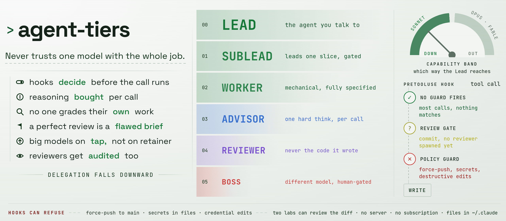

<a name="top"></a>
<p align="center">
  <picture>
    <source media="(prefers-color-scheme: dark)" srcset="./docs/assets/agent-tiers-banner-dark.png">
    <source media="(prefers-color-scheme: light)" srcset="./docs/assets/agent-tiers-banner-light.png">
    
  </picture>
</p>

<p align="center">
  <em>No single model gets the whole job. <strong>The right model for each job.</strong><br>
  <strong>Hooks block the dangerous stuff</strong> before it happens.</em>
</p>

<p align="center">
  
  
  <a href="https://github.com/godilley/agent-tiers/actions/workflows/selfcheck.yml"></a>
  <a href="LICENSE"></a>
</p>

<hr>

<p align="center">
  <a href="#see-it-work">See it work</a> ·
  <a href="#install">Install</a> ·
  <a href="#documentation">Docs</a> ·
  <a href="docs/hooks.md">Hooks</a> ·
  <a href="docs/what-ships.md">What ships</a> ·
  <a href="docs/extending.md">Extend the tiers</a> ·
  <a href="docs/uninstall.md">Uninstall</a> ·
  <a href="#history">History</a>
</p>

<hr>

A portable Claude Code plugin that installs a sub-agent tier system into any project, and
**self-configures by probing the local environment** - so it works regardless of project state, editor,
or which Claude Code GUI / editor-addon is in use ([why a probe](docs/after-install.md#why-a-probe)).

| Tier | Job |
|---|---|
| **Lead** | The agent you talk to. Routes work rather than doing all of it. |
| **Sublead** | Leads one independent slice of a big task over its own workers. Opus, gated per spawn. |
| **Worker** | Cheap and fast. Handles mechanical, fully-specified jobs. |
| **Advisor** | One hard think, bought per call, when a decision needs real reasoning. |
| **Reviewer** | Checks the diff - whoever wrote it is the worst person to review it. |
| **Boss** | A different model, called in only when the Lead is genuinely stuck. |

Two things this buys. **Routing:** the Lead stays the brains of the session - it plans, routes,
briefs and verifies - and each job is bought per call from the model that fits it: mechanical work
from a fast Sonnet or Haiku worker, a hard decision from an Opus advisor, a risky diff from an
independent or cross-lab reviewer. How it routes depends on the Lead's model: a Sonnet Lead buys hard
calls from an Opus advisor instead of grinding them at its own depth; an Opus or Fable Lead already
holds that depth, so it hands mechanical jobs to Workers and buys independence instead. The
lever is the per-token price gap between models (public pricing); the kit keeps no spend record, so
it cannot show a before/after bill. What it can show is which tier ran, per spawn, via the check-in
line. **Safety:** the rules that must not depend on an agent remembering them are wired as
**hooks** your CLI runs before a tool call - force-pushes, secrets, credential edits can be
hard-stopped, not remembered-about (guards are opt-in, in groups you pick at install). Nothing
here needs a server or a subscription: files in `~/.claude` and POSIX shell.

> [!NOTE]
> Assumes you already know Claude Code plugins, hooks, and subagents - see
> [Anthropic's Claude Code docs](https://docs.claude.com/en/docs/claude-code) first if you don't.

The **Lead** (your main chat) runs whatever model you pick in your GUI's model panel. It converses,
routes, briefs and verifies, and the doctrine adapts to its model: a Sonnet Lead buys deeper
reasoning per call, an Opus or Fable Lead reaches *out* for independent review instead of *down* for
capability, and both send mechanical work to a Worker. The kit only configures
and *verifies* the sub-agents; it never pins the Lead's model or effort.

## See it work<a href="#top"></a>

Real captured output, not mockups. The guards are plain scripts reading the hook's JSON from
stdin, so the refusal below is reproducible by piping the same payload yourself.

**A force-push stopped before it runs** (`dangerous-actions-blocker`):

```console
$ printf '{"tool_name":"Bash","tool_input":{"command":"git push --force origin master"}}' \
    | sh scripts/dangerous-actions-blocker.sh
```
```json
{
  "hookSpecificOutput": {
    "hookEventName": "PreToolUse",
    "permissionDecision": "deny",
    "permissionDecisionReason": "Force-push targeting main/master is a hard deny. What to do now: there is no override for this in the session - do not retry a variant or route around it with another tool. Tell the operator what was blocked and why; if they still want it done, they run it themselves in a real terminal."
  }
}
```

Note the reason text: it briefs the *agent* on what to do next, not just the human. A guard that
only says "no" invites the model to try a variant; these close that door explicitly.

More captured output, from the other guards and from doctrine firing mid-session, is in
[docs/hooks.md](docs/hooks.md#guards-in-action); a spawn's check-in line is in
[docs/what-ships.md](docs/what-ships.md#the-check-in-line).

Skeptical? Good - distrust is the posture this kit is built on, and it applies to the kit itself.
Paste the [review prompt](docs/prompts/review.md) into a fresh Claude session: it audits the kit
as inert data and reports, installing nothing.

## Install<a href="#top"></a>

Needs `jq`: the `agent-tiers` CLI needs it, and so does every hook to read your options
([requirements](docs/install.md#requirements)). Use one route per Claude Code profile, never both:
every hook would run twice.

### Plugin route

For a host that loads Claude Code plugins (the Claude Code CLI does). Inside Claude Code:

```text
/plugin marketplace add godilley/agent-tiers
/plugin install agent-tiers@agent-tiers
```

Then run **`/agent-tiers:init`** in any project. With `jq` installed, a fresh install runs at the
`core` level, with no guards on; pick a level or groups with **`/agent-tiers:setup`**.

### Flat route

For a host that ignores plugins but scans plain `~/.claude/{skills,agents,commands}` files:

```bash
git clone https://github.com/godilley/agent-tiers ~/.claude/agent-tiers
sh ~/.claude/agent-tiers/scripts/agent-tiers install
```

`agent-tiers install` asks for a level ([levels and groups](docs/hooks.md#levels-and-groups)),
prints a plan of what it will change, and asks again before applying it. **New agent types need a host restart**; then run **`/agent-tiers-init`** in any
project.

Rather have your agent drive? Paste the [install prompt](docs/prompts/install.md) into a Claude
Code session: it clones to a temp dir, audits, plans, and waits for your confirmation before
writing anywhere. Updating, switching routes and setup options: [docs/install.md](docs/install.md).

## Documentation<a href="#top"></a>

| Page | Read it for |
|---|---|
| [Install and setup](docs/install.md) | Both routes in full, requirements, updating, and changing the setup later: switch level, turn one group or one hook off, turn the whole kit off |
| [Hooks and guards](docs/hooks.md) | The hooks and their groups, levels, what to do when a guard blocks you, reach-guard, network posture (the hooks make no outbound calls) and how the guards are maintained, more captured output |
| [What ships](docs/what-ships.md) | Agents, skills, commands, config and scripts, item by item; the check-in line |
| [Extending the tiers](docs/extending.md) | The 3-layer project extension, and the optional companions |
| [After install](docs/after-install.md) | What the kit wrote and why, where your choices are stored, the reach-guard allowlist, a second Claude account, per-install settings |
| [Uninstall](docs/uninstall.md) | The remover, what it leaves behind, removing only the hook rows |
| [Private notes](docs/private-notes.md) | Keeping private planning docs out of a repo's tracked history |

## History<a href="#top"></a>

One entry per shared bundle: [`CHANGELOG.md`](CHANGELOG.md).
