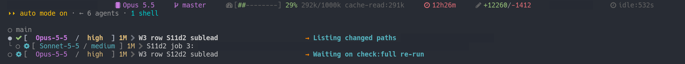

<a name="top"></a>
<h1 align="center">Using the kit</h1>

<p align="center"><i>What working with agent-tiers looks like, day to day</i></p>

<div align="center">

| [**README**](../README.md) | **Why delegate** | [**Work shapes**](work-shapes.md) | [**Levels**](levels.md) | [**Plan waves**](plan-wave.md) | [**Glossary**](glossary.md) |
|:-:|:-:|:-:|:-:|:-:|:-:|

</div>

<hr>

> [!NOTE]
> **agent-tiers** is a Claude Code plugin: helpers do the work, guards block risky commands.

| You get<br> | Which means<br> |
|---|---|
| **More freedom** | **Delegates**<br><i>&rsaquo; Helpers work in parallel, even while you are away.</i> |
| **More protection** | **Blocks risky commands**<br><i>&rsaquo; And says what to do instead.</i> |
| **Fewer silent failures** | **Catches quiet failures**<br><i>&rsaquo; Commands that look fine and are not.</i> |

> [!TIP]
> A **guard** is a script that runs before each command and can block it.

Every number on this page comes from one maintainer's own sessions, a heavy and unusual user: read them as a ranking of what is common, not as a prediction for you.


<details>
<summary><b>Which quiet failures?</b></summary>

| Command<br> | Looks like | Actually |
|---|---|---|
| `pgrep -f name` | finds the process | can match **its own shell**, so it can report a process that is not there |
| `pnpm test \| tail` | shows the result | hides the **exit code**, so a failed check reads as passed |
| a poll loop | waits for a job | **never ends** if the job never finishes |
| `grep -r` | searches everything | **skips binary files** without saying so |

</details>

---

<a name="why-delegate-at-all"></a>

<h3 align="center">🎯 Why delegate at all 🎯<a href="#top"></a></h3>
<p align="center"><sub>Six effects, <b>one real example each</b>.</sub></p>

| Effect<br> | What you see<br> | As it looks<br> |
|---|---|---|
| 💬 [**You stay in the loop**](#you-stay-in-the-conversation) | **Keeps talking**<br><i>&rsaquo; The main session stays with you.</i> | `14 min window; 6 messages typed; 8 notes forwarded`<br><sub><i>summary of one capture; the main session never waited for the helper</i></sub> |
| 👀 [**Fresh eyes**](#fresh-eyes-on-every-change) | **Never self-reviewed**<br><i>&rsaquo; A separate reviewer reads it cold.</i> | `found 7 real + caught the planted control`<br><sub><i>the control proves it read the change</i></sub> |
| ⚖️ [**Right model per job**](#the-right-model-per-job) | **Fast or strong**<br><i>&rsaquo; Routine to fast, hard calls to strong.</i> | `Explore 79 (72 sonnet); worker 60; reviewer 39; advisor 11`<br><sub><i>counts over 24 sessions, 240 helpers</i></sub> |
| 🔀 [**Parallel work**](#parallel-work) | **At the same time**<br><i>&rsaquo; Own copy of the repo each.</i> | `[opus / high] W3 row S11d2 sublead`<br><sub><i>[opus / high] W3 row S12d2 sublead</i></sub> |
| 🧹 [**A clean thread**](#a-clean-thread) | **Only the report**<br><i>&rsaquo; Logs stay with the helper.</i> | `sublead, row P1: 221,451 tokens used`<br><sub><i>one report reached the main session</i></sub> |
| 📥 [**One question box**](#one-place-for-questions) | **One batch**<br><i>&rsaquo; Helper questions come to you together.</i> | `FORK: [...] readings: (1) fix them now (2) revert item 4; default: (1)`<br><sub><i>a helper's open decision, put to you with 3 others in one box</i></sub> |

---

<a name="you-stay-in-the-conversation"></a>

<h3 align="center">💬 You stay in the conversation 💬<a href="#top"></a></h3>
<p align="center"><sub>The main session keeps talking to you <b>while helpers work</b>.</sub></p>

<kbd>How</kbd> helpers run **in the background**. The main session stays free.<br>
<kbd>You can</kbd> send new instructions mid-job. The main session passes them on.

#### Real example
| Measured<br> | In one real session |
|---|---|
| While one helper ran, in a | **14 minute** window |
| The person sent | **6 messages** |
| The main session forwarded | **8 notes** to the running helper, without waiting for it |

---

<a name="fresh-eyes-on-every-change"></a>

<h3 align="center">👀 Fresh eyes on every change 👀<a href="#top"></a></h3>
<p align="center"><sub>A separate reviewer checks each change. The writer never reviews its own.</sub></p>

<kbd>Why</kbd> the agent that wrote a change shares its own blind spots.<br>
<kbd>How</kbd> a **reviewer** starts with no memory of the writing and reads the change cold.<br>
<kbd>Proof it read it</kbd> the brief hides **one known mistake**. If the reviewer reports it, it read the change.

#### Real example
| Measured<br> | In one real review |
|---|---|
| One review found | **7 real problems**, plus the hidden one |
| What that proves | reading, not that nothing was missed |

---

<a name="the-right-model-per-job"></a>

<h3 align="center">⚖️ The right model per job ⚖️<a href="#top"></a></h3>
<p align="center"><sub>Routine work goes to a fast model. <b>Hard calls go to a strong one.</b></sub></p>

<kbd>Fast model</kbd> Sonnet or Haiku: searches, routine edits, running checks.<br>
<kbd>Strong model</kbd> Opus: design questions, reviews, hard calls.<br>
<kbd>You choose</kbd> nothing per job. Each kit helper type has its model set in its own file; Claude Code's own Explore has none, so a spawn names it (and a guard denies one that does not).

#### Real example
| Measured<br> | Over 24 sessions |
|---|---|
| Helpers started by the main session | **240** |
| Routine (Explore, worker) | mostly **Sonnet** |
| Reviews and advice (reviewer, advisor) | **Opus** |

---

<a name="parallel-work"></a>

<h3 align="center">🔀 Parallel work 🔀<a href="#top"></a></h3>
<p align="center"><sub>Separate jobs run at once, each in its own copy of the repo.</sub></p>



*Two helpers on two plan rows at the same time; one has a Sonnet child, the other waits on its check.*

<kbd>How</kbd> each job gets its own **git worktree**: a separate copy of the repo on its own branch.<br>
<kbd>Why</kbd> two helpers never edit the same files at once. Work merges back one job at a time.

---

<a name="a-clean-thread"></a>

<h3 align="center">🧹 A clean thread 🧹<a href="#top"></a></h3>
<p align="center"><sub>Logs and dead ends stay with the helper. <b>You get its report.</b></sub></p>

<kbd>How</kbd> a helper's file reads, test output and dead ends stay in **its own context**.<br>
<kbd>You see</kbd> only its **final report**, so the main session stays short.

#### Real example
| Helper<br> | Tokens it reported at exit | What reached the main session |
|---|---|---|
| sublead, row P1 | **221,451** | its final report |
| sublead, row RD1 | **160,346** | its final report |
| reviewer, a doctrine review | **121,597** | its findings |

The token field's exact meaning is undocumented: these are examples, never a total and never a saving.


---

<a name="one-place-for-questions"></a>

<h3 align="center">📥 One place for questions 📥<a href="#top"></a></h3>
<p align="center"><sub>A helper's questions come back to the main session, which asks you in one batch.</sub></p>

<kbd>Why</kbd> a helper **cannot ask you** directly.<br>
<kbd>How</kbd> it stops and returns its open choice to the main session.<br>
<kbd>You see</kbd> **one question box** with every open choice, each with a **suggested answer**.

#### Real example
A helper returned this instead of guessing (trimmed):

```text
FORK: removing Write from the reviewer leaves doctrine and two commands saying it has Write
  readings: (1) fix them now [...] (2) revert item 4 and keep the Write-based def
  default: (1), because item 4 was asked for and doctor would otherwise flag every install
  cost: 4 files, 7 sites, 1 doctrine-vN bump [...]
```

The main session put it to the person together with **3 other open decisions**, as one box, answered in under two minutes.
