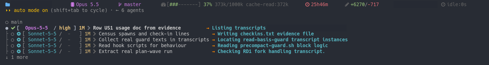

<a name="top"></a>
<h1 align="center">Work shapes</h1>

<p align="center"><i>The everyday jobs, most common first: what the helper does on its own, and what stops it going wrong</i></p>

<div align="center">

| [**README**](../README.md) | [**Why delegate**](usage.md) | **Work shapes** | [**Levels**](levels.md) | [**Plan waves**](plan-wave.md) | [**Glossary**](glossary.md) |
|:-:|:-:|:-:|:-:|:-:|:-:|

</div>

<hr>

> [!NOTE]
> The six everyday jobs, most common first. Each one names its helper, its guard, and the install level that switches the guard on.

| Shape<br> | What happens<br> | As it looks<br> |
|---|---|---|
| ⏳ [**A long session**](#a-long-session) | **Runs while you are away**<br><i>&rsaquo; Questions wait in one box.</i> | `Opus Lead; context 37%; 25h46m; 6 agents`<br><sub><i>summarised from the status line below; one helper row reads [sonnet / medium] worker -> Census spawns and check-in lines</i></sub> |
| 🔍 [**A read-only sweep**](#a-read-only-sweep) | **Several fast readers at once**<br><i>&rsaquo; Nothing gets written.</i> | `Explore, model: sonnet, "Classify 11 docs STATUS"`<br><sub><i>Read-only classification task. Do not edit anything.</i></sub> |
| 🔧 [**A routine change**](#a-routine-change) | **Write, review, commit**<br><i>&rsaquo; Three different hands.</i> | `Hi, I'm worker - Worker tier, def-v8. Fixed the codex-guard.sh heredoc-scan defect`<br><sub><i>Result: 8 CONFIRMED, 2 REFUTED, 0 UNVERIFIABLE.</i></sub> |
| 🧭 [**A design question**](#a-design-question) | **One read-only opinion**<br><i>&rsaquo; Findings plus a confidence.</i> | `Hi, I'm advisor - Advisor tier, def-v9. Pressure-testing the planted-control redesign`<br><sub><i>HANDOFF: adopt the liveness/recall split with three changes.</i></sub> |
| 🔀 [**A multi-part plan**](#a-multi-part-plan) | **Rows in parallel**<br><i>&rsaquo; Own copy of the repo each.</i> | `[sublead-approved: plan row REQ1, wave 2026-10-15]`<br><sub><i>Run wave 5 as laid out above (REQ1, I9, M1 now; I7 after REQ1 merges)?</i></sub> |
| 🛑 [**A risky command**](#a-risky-command) | **Blocked, with the next step**<br><i>&rsaquo; Before it runs, not after.</i> | `grep-footgun-guard: Re-run with 'rg' (preferred) or add '-a' to grep.`<br><sub><i>long-run-guard: never pipe (\| or \|&) into another command, never run_in_background [...]</i></sub> |

> [!TIP]
> A **level** is which set of guards you installed: `core` (none), `recommended`, or `full`. Picking one, or turning a single guard off: [Levels](levels.md).

---

<a name="a-long-session"></a>

<h3 align="center">⏳ A long session ⏳<a href="#top"></a></h3>

<p align="center"><sub>Hours of work, several helpers, <b>you dropping in and out</b>.</sub></p>



*One session, 26 hours in. One sublead and its four Sonnet children, each on a named task. Context 37% since the last compaction, about 11 hours earlier. Folder and session id masked.*

#### What runs
<kbd>Helpers</kbd> plan rows, in the background, each in its own copy of the repo.<br>
<kbd>Main session</kbd> idles between reports and passes your messages on.

#### What comes back to you
<kbd>Questions</kbd> one box, a marked default, never a guess.<br>
<kbd>Hand-backs</kbd> the few commands only you may run, with the reason.

#### When you are away
<kbd>Unattended mode</kbd> `/agent-tiers:unattended on`: a question becomes an instruction the helper can act on.<br>
<kbd>Level</kbd> `full` for unattended mode and batched questions (`unattended-guard`, `ask-gate`, `subagent-bg-return-guard`); the helpers themselves need no level.


> [!WARNING]
> **Still stops** at what only you may do: a commit that touches a guard's own files, a command that changes something on another machine. Those are handed back for you to run; a read-only command on another machine asks first.

What unattended mode changes:

```diff
- AskUserQuestion: "Which of the two readings?"
  halts until someone answers
+ deny: take the reading that keeps existing behaviour and is the smaller diff; note the fork; continue
```

#### Real example

| Elapsed<br> | What happened |
|---|---|
| 0h00 | `/plan-wave` on a plan doc. One question box, answered in 70 s. Three helpers spawned. |
| 0h32 | First row merged after review. |
| 9h15 | A burst: 4 helpers in 22 minutes, 11 question boxes, 16 messages typed in the hour. |
| 13h18 | Unattended mode on. The person leaves. |
| 13h29 | A guard refuses a merge commit: it names a file only the person may change. Three commands handed back. |
| 19h51 | The person is back and runs them. Two more helpers spawned. Merges at 20h56 and 21h16. |

---

<a name="a-read-only-sweep"></a>

<h3 align="center">🔍 A read-only sweep 🔍<a href="#top"></a></h3>

<p align="center"><sub>Look through some files and report back.</sub></p>

#### What runs
<kbd>Helper</kbd> **Explore**, Claude Code's own read-only agent, on a fast model. Several at once.<br>
<kbd>On its own</kbd> reads, classifies, returns a table. The main session decides what to write.

#### What stops it going wrong
<kbd>Guard</kbd> `task-spawn-guard` denies an Explore spawn with no model named.<br>
<kbd>Level</kbd> `full`.

```diff
- Agent  subagent_type: Explore
  denied: it would inherit the main session's model
+ Agent  subagent_type: Explore  model: sonnet
```

#### Real example

| What<br> | As it went |
|---|---|
| Spawn | `Explore`, `model: sonnet`, "Classify 11 docs STATUS" |
| Prompt began | "Read-only classification task. Do not edit anything." |
| Back in | **73 s**, one table |
| Then | the main session spot-checked the cited evidence before using it |

---

<a name="a-routine-change"></a>

<h3 align="center">🔧 A routine change 🔧<a href="#top"></a></h3>

<p align="center"><sub>A small, fully specified fix.</sub></p>

#### What runs
<kbd>Worker</kbd> fast model, can edit and run commands, in its own copy of the repo.<br>
<kbd>Reviewer</kbd> strong model, read-only, reads the diff cold and returns findings.<br>
<kbd>Main session</kbd> commits.

#### What stops it going wrong
<kbd>Review gate</kbd> `review-gate-guard` asks once per session per repo before a commit with no review in it.<br>
<kbd>Hygiene</kbd> `hygiene-commit-guard` denies a commit carrying an em dash, curly quote or odd space.<br>
<kbd>Staging</kbd> `git-add-stash-guard` denies blanket staging and every `git stash` except `list` and `show`.<br>
<kbd>Level</kbd> `recommended`.

```diff
- git add -A && git commit -m "fix"
  blanket staging, and no review in the session yet
+ git add src/one.ts src/two.ts
+ Agent  subagent_type: reviewer
+ git commit
```

#### Real example

| Who<br> | What it said |
|---|---|
| Worker brief, trimmed | "[...] Edit only scripts/codex-guard.sh [...]. No commit, no stash, no spawning agents." |
| Worker reported | `Hi, I'm worker - Worker tier, def-v8. Fixed the codex-guard.sh heredoc-scan defect` |
| Reviewer reported | `Result: 8 CONFIRMED, 2 REFUTED, 0 UNVERIFIABLE.` |
| One refuted claim | the mistake planted in the brief on purpose: proof the reviewer read the diff |

---

<a name="a-design-question"></a>

<h3 align="center">🧭 A design question 🧭<a href="#top"></a></h3>

<p align="center"><sub>Which of two designs, or <b>what is wrong with this plan</b>.</sub></p>

#### What runs
<kbd>Advisor</kbd> strong model, read-only, one bounded question.<br>
<kbd>Returns</kbd> findings, a recommendation and a confidence.

#### What stops it going wrong
<kbd>Check</kbd> it cannot edit or run anything; the main session verifies its citations before folding the answer in.<br>
<kbd>Bonus</kbd> an advisor spawn counts as a review for `review-gate-guard`.<br>
<kbd>Level</kbd> none needed.

#### Real example

| Who<br> | What it said |
|---|---|
| Advisor reported | `Hi, I'm advisor - Advisor tier, def-v9. Pressure-testing the planted-control redesign` |
| Recommendation | `HANDOFF: adopt the liveness/recall split with three changes.` |
| Main session next | "Advisor citations verified (SKILL.md:166-177, template:49-50, task-spawn-guard:86). Folding advisor result into plan." |

---

<a name="a-multi-part-plan"></a>

<h3 align="center">🔀 A multi-part plan 🔀<a href="#top"></a></h3>

<p align="center"><sub>Several rows at once, merged in a set order.</sub></p>


*Two subleads on two plan rows at once; one has a Sonnet child, the other is waiting on its check re-run.*

#### What runs
<kbd>Sublead</kbd> one per plan row, each in its own copy of the repo.<br>
<kbd>Main session</kbd> states the wave once, gets your yes, spawns, reviews each result and merges in order. Full steps: [Plan waves](plan-wave.md).

#### What stops it going wrong
<kbd>Guard</kbd> `task-spawn-guard` asks before a sublead spawn that carries no approval tag.<br>
<kbd>Level</kbd> `full` for the guard; the skill itself ships with the kit.

---

<a name="a-risky-command"></a>

<h3 align="center">🛑 A risky command 🛑<a href="#top"></a></h3>

<p align="center"><sub>Dangerous, or quietly broken: it looks fine <b>and is not</b>.</sub></p>

#### What happens
<kbd>Guard</kbd> runs before the command, denies it, and its message names the next step.<br>
<kbd>Most often</kbd> a recursive `grep` that skips "binary" files (`grep-footgun-guard`); a `pgrep -f` that can match its own shell (`pgrep-footgun-guard`); a long check piped into `tail` (`long-run-guard`); a commit with no review (`review-gate-guard`).

#### Level
<kbd>Level</kbd> `recommended` for all of the above.


> [!WARNING]
> **Handed back, not fixed:** a force-push, a publish, anything that changes something on another machine or account. Those come to you with the reason; a read-only command on another machine asks first.

What a deny turns into, most of the time:

```diff
- grep -r "pattern" src/
  skips files it deems binary, says nothing
+ rg "pattern" src/

- pnpm test | tail -20
  the pipe hides the exit code
+ pnpm test

- git add -A
  stages scratch files too
+ git add src/one.ts src/two.ts
```

#### Real example

The guards that fire most, from one maintainer's log over two months. Counts rank how often each pitfall came up, not harm prevented.

| Guard<br> | Fired | Without it |
|---|---|---|
| `grep-footgun-guard` | 1729 | Recursive `grep` skips "binary" files, so "no matches" can be false. |
| `pgrep-footgun-guard` | 305 | `pgrep -f` can match the shell running it, so "still running?" can be a false yes. |
| `review-gate-guard` | 301 | A commit or push goes out with no independent review. |
| `long-run-guard` | 195 | A build or check piped, backgrounded or under-timed ends with no exit code. |
| `sc52a-write-disclosure-guard` | 160 | `sed -i` or `tee` on a tracked file with no stated reason. |
| `memory-write-gate` | 124 | A memory note written without checking it is already recorded. |
| `hygiene-commit-guard` | 117 | A commit carries an em dash, curly quote or odd space. |
| `security-gate` | 63 | A live-looking key or hard-coded secret about to be written. |
| `simple-rules-guard` | 62 | Small literal rules: a question box whose first option is not marked, a message that could resume a finished agent by accident. |
| `git-add-stash-guard` | 59 | Blanket `git add` stages scratch files; `git stash` takes another session's work. |
| `reach-guard` | 54 | A helper reaches another machine or a logged-in account. |

Not in the table but on at the same levels: `vcs-commit-guard` (a commit that includes a file the repo marks private), `read-basis-guard` (a plan naming files the session never read), `notify-tag-guard` and `ask-gate` (the reply tag and the question box, see [Levels](levels.md#full)), `subagent-bg-return-guard` (a helper returning while its background command still runs), `unattended-guard` (a question box or plan mode with nobody there to answer). Also `worktree-guard` (a hand-typed `git worktree add` or `remove` that skips the kit's recipe), `peer-guard` (a session writing into another repo without reading its docs) and `dangerous-actions-blocker` (a force-push to main, a publish, a protected credential file). Hook ids for `disabled_hooks` are the `hook` rows of `install/options.tsv`; groups and more captures in [Hooks and guards](hooks.md).

<details>
<summary><b>Two rarer shapes</b></summary>

- **Genuinely stuck: the Boss.** A different model from the main session, called in only after repeated failed attempts, on a distilled brief. It decides and never edits. It always needs your yes.
- **A second lab's opinion: `codex-read` and `codex-write`.** Opt-in, per session, needing the `codex` CLI. The read path returns another lab's findings; the write path's output always gets a Claude review. `codex-guard` (level `full`) routes a bare `codex` call through the kit's wrapper.

</details>
